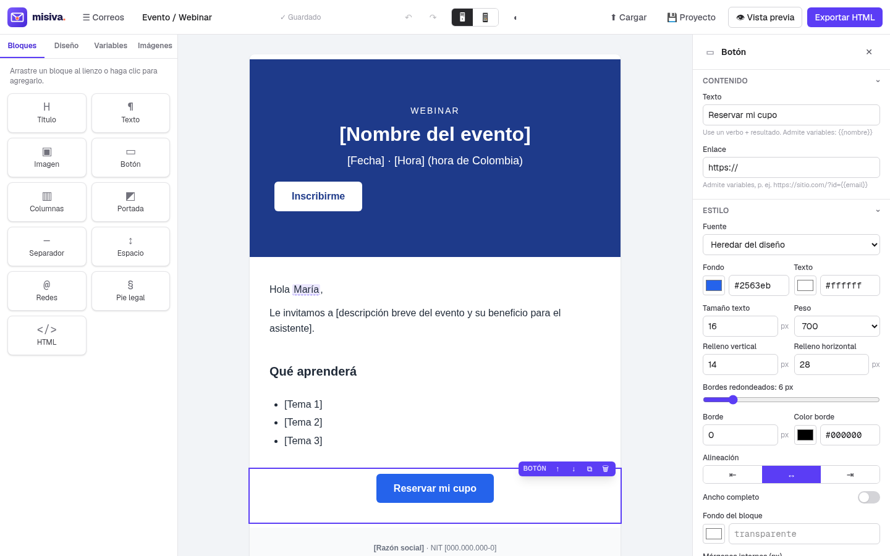

<p align="center">
  
</p>

<p align="center">
  <strong>Editor visual de código abierto para crear correos HTML que se ven bien en todas partes.</strong><br>
  Gmail · Outlook · Apple Mail · Yahoo · Samsung Mail · Thunderbird — y exportación lista para SendGrid, Mailchimp, Brevo, HubSpot y más.
</p>

<p align="center">
  <strong>Desarrollado con Claude y Codex por Zegiru Labs.</strong>
</p>

<p align="center">
  <a href="LICENSE"></a>
  
  
  
  
</p>

<p align="center">
  
</p>

---

## Contenido

- [Qué es Misiva](#qué-es-misiva)
- [Características](#características)
- [Inicio rápido](#inicio-rápido)
- [Ejecutar en desarrollo](#ejecutar-en-desarrollo)
- [Compilar](#compilar)
  - [Servidor propio con Docker](#servidor-propio-con-docker)
  - [Versión web](#versión-web)
  - [App de escritorio](#app-de-escritorio)
  - [Publicar una versión con GitHub Actions](#publicar-una-versión-con-github-actions)
- [Cómo se usa](#cómo-se-usa)
- [Configuración](#configuración)
- [Integración MCP para asistentes de IA](#integración-mcp-para-asistentes-de-ia)
- [Arquitectura](#arquitectura)
- [Solución de problemas](#solución-de-problemas)
- [Contribuir](#contribuir)
- [Marca](#marca)
- [Licencia](#licencia)

## Qué es Misiva

*Misiva* (del latín *missīva*, «carta que se envía») es un editor de correos HTML con arrastrar y soltar.
Arma el correo con bloques, personalízalo con variables, revisa que sea compatible y exporta el HTML con
la sintaxis exacta de tu plataforma de envío. Funciona en el navegador o como app de escritorio, sin
cuentas ni servicios externos.

## Características

**Editor**
- 11 bloques: título, texto enriquecido, imagen, botón, columnas (2–4), portada con imagen de fondo,
  separador, espacio, redes sociales, pie legal con enlace de baja y HTML libre.
- Arrastrar y soltar, duplicar, reordenar, deshacer/rehacer y atajos de teclado.
- Estilo por bloque: fuentes, tamaños, colores, márgenes, bordes, alineación y fondo.
- Visibilidad: ocultar en móvil, mostrar solo en móvil o mostrar solo si una variable tiene valor.
- Diseño global: ancho, fondos, tipografía y fuente web, colores para modo oscuro, UTM y CSS propio.
- Plantillas de inicio: boletín, evento/webinar, promoción y notificación.

**Variables y plataformas**
- Sintaxis única en el editor (`{{nombre}}`, `{{nombre|"amigo"}}`, `{{#if x}}…{{/if}}`) que se traduce al
  exportar a: Genérico, SendGrid, Mailchimp, Brevo, HubSpot, Mailgun, Amazon SES, Postmark, Mailjet,
  Klaviyo, ActiveCampaign, Salesforce Marketing Cloud, Zoho Campaigns o patrones personalizados.
- Nombre del campo configurable por plataforma (p. ej. `nombre` → `FNAME` en Mailchimp).
- Importación de variables desde la cabecera de un CSV.

**Compatibilidad**
- Maquetación con tablas y estilos en línea, tabla fantasma y VML para Outlook escritorio.
- Columnas híbridas que se apilan en móvil incluso sin media queries (app de Gmail).
- Preheader, modo oscuro (`prefers-color-scheme` y Outlook.com) e imágenes alternativas para modo oscuro.
- Revisión automática antes de exportar: peso frente al límite de 102 KB de Gmail, imágenes sin `alt` o
  sin ancho, rutas locales, enlaces vacíos o `http`, falta de enlace de baja, etiquetas prohibidas y
  variables sin definir.

**Entrada y salida**
- Exporta HTML (normal o minificado), versión en texto plano y JSON de datos de ejemplo.
- Carga plantillas HTML completas y hojas CSS separadas. Permite modificar contenido visualmente, editar
  el HTML y los bloques `<style>` en pestañas dedicadas, con vista previa en vivo; convierte merge tags de
  otras plataformas (`*|FNAME|*`, `{{ contact.X }}`, `%%X%%`…) a variables.
- Importación híbrida: adapta títulos, textos, imágenes, botones, separadores y tablas de 2–4 columnas a
  bloques nativos; conserva automáticamente las secciones complejas como HTML y muestra un informe antes
  de crear el proyecto.
- Guarda y abre proyectos `.json`; guardado automático en el navegador.
- Biblioteca de imágenes con subida por arrastre.
- Vista previa en escritorio, tablet y móvil, con modo oscuro simulado e imágenes bloqueadas.

## Inicio rápido

**Requisitos:** [Node.js](https://nodejs.org/) 20.9 o superior (recomendado 22 LTS; el repositorio
incluye `.nvmrc`) y npm. Git es opcional.

```bash
git clone <url-del-repositorio> misiva
cd misiva
nvm use            # opcional, si usa nvm
npm install
npm run dev
```

Abra <http://localhost:3000>. La primera vez verá un boletín de ejemplo.

> Si solo quiere usar la app de escritorio, descargue el instalador de la sección **Releases** del
> repositorio (cuando haya versiones publicadas).

## Ejecutar en desarrollo

| Comando                | Qué hace                                                                          |
| ---------------------- | --------------------------------------------------------------------------------- |
| `npm run dev`          | Versión web con recarga en caliente en <http://localhost:3000>.                   |
| `npm run electron:dev` | App de escritorio sobre `next dev`. Reutiliza el servidor de `:3000` si ya corre. |
| `npm run lint`         | ESLint.                                                                           |
| `npx tsc --noEmit`     | Revisión de tipos.                                                                |

En desarrollo, las imágenes subidas se guardan en `storage/uploads/` (ignorado por git).

## Compilar

### Versión web

```bash
npm run build      # compila
npm start          # sirve en http://localhost:3000
```

`next build` genera además un servidor autónomo en `.next/standalone` que no necesita `node_modules`.
Para desplegarlo en un servidor propio:

```bash
npm run electron:build                      # build + copia de public/ y .next/static al standalone
cd .next/standalone
PORT=8080 HOSTNAME=0.0.0.0 MAILING_STORAGE_DIR=/var/lib/misiva node server.js
```

Para una instalación multiusuario configure `DATABASE_URL`. Misiva habilita entonces registro, inicio de
sesión, proyectos aislados por cuenta y tokens MCP revocables. Publique siempre detrás de HTTPS.

Para que los destinatarios vean las imágenes subidas, el servidor debe ser accesible desde internet y
debe poner su URL en **Diseño → Compatibilidad y exportación → URL pública de las imágenes**. En
plataformas sin disco persistente (p. ej. Vercel), reemplace `app/api/upload/route.ts` por un
almacenamiento externo (S3, R2, Cloudinary…).

### App de escritorio

| Comando                  | Resultado                                                           | Dónde compilar           |
| ------------------------ | ------------------------------------------------------------------- | ------------------------ |
| `npm run electron:start` | Compila y abre la app en modo producción, sin empaquetar.           | Cualquiera               |
| `npm run dist:linux`     | `dist-electron/Misiva-<versión>-linux-x86_64.AppImage`              | Linux                    |
| `npm run dist:win`       | `dist-electron/Misiva-<versión>-win-x64.exe` (instalador NSIS)      | Windows (o Linux + Wine) |
| `npm run dist:mac`       | `dist-electron/Misiva-<versión>-mac-<arch>.dmg`                     | macOS                    |
| `npx electron-builder --linux dir` | Carpeta sin empaquetar en `dist-electron/linux-unpacked/` (útil para probar) | Linux |

Notas:

- Los instaladores salen **sin firmar**. Windows SmartScreen y macOS Gatekeeper mostrarán una
  advertencia. Para firmar, configure los certificados según la
  [documentación de electron-builder](https://www.electron.build/code-signing).
- Para generar también un paquete `.deb`, añada `"deb"` a `build.linux.target` en `package.json` y un
  correo en `author` (electron-builder lo exige como mantenedor).
- El ícono de la app está en `build/icon.png` (1024 × 1024).

### Servidor propio con Docker

El modo self-hosted usa PostgreSQL para usuarios, sesiones, tokens MCP y proyectos. Las imágenes se guardan
en un volumen persistente y su propiedad queda asociada a la cuenta en PostgreSQL.

```bash
cp .env.example .env
# Edite .env y defina POSTGRES_PASSWORD y APP_ORIGIN.
docker compose up -d --build
```

Misiva quedará en <http://127.0.0.1:3000>. El `compose.yaml` escucha solamente en loopback a propósito.
Al abrirlo por primera vez, cree la cuenta inicial desde **Registrarse**. Para publicarlo, coloque Caddy,
Traefik o nginx delante y habilite HTTPS. No exponga PostgreSQL ni el puerto 3000 directamente a internet.

Las imágenes viven en `misiva_data`; usuarios, sesiones, tokens y proyectos viven en `postgres_data`.
Para detener sin borrar datos use `docker compose down`; no use `docker compose down -v` salvo que realmente
quiera eliminar toda la instalación.

### Publicar una versión con GitHub Actions

El repositorio incluye dos flujos en `.github/workflows/`:

- **CI** (`ci.yml`): en cada *push* a `main` y en cada *pull request* ejecuta lint, revisión de tipos y build.
- **Release** (`release.yml`): al subir una etiqueta `v*` compila los instaladores de Linux, Windows y
  macOS en sus propios sistemas y los adjunta a un **borrador** de *release*.

```bash
# 1. Actualice "version" en package.json y CHANGELOG.md
git commit -am "Versión 0.2.0"
git tag v0.2.0
git push origin main --tags
# 2. En GitHub → Releases, revise el borrador y publíquelo
```

## Cómo se usa

1. **Elija una plantilla** en *☰ Correos* o empiece en blanco.
2. **Arrastre bloques** desde el panel izquierdo y edítelos en el panel derecho.
3. **Defina el asunto y el preheader** en *Diseño → Mensaje*.
4. **Inserte variables** desde el editor de texto o escribiéndolas a mano.
5. **Revise** con *Vista previa* (móvil, modo oscuro, imágenes bloqueadas, datos de prueba).
6. **Exporte**: elija la plataforma, revise la pestaña *Revisión* y descargue el `.html` y el `.txt`.

### Sintaxis de variables

| Escriba                         | Significado                                    |
| ------------------------------- | ---------------------------------------------- |
| `{{nombre}}`                    | Variable                                       |
| `{{nombre\|"amigo"}}`           | Variable con valor por defecto si llega vacía  |
| `{{#if empresa}}…{{else}}…{{/if}}` | Contenido condicional                       |
| `{{@unsubscribe}}`              | URL de baja                                    |
| `{{@preferences}}`              | URL de preferencias                            |
| `{{@webversion}}`               | URL de la versión web                          |

Ejemplo de exportación de `Hola {{nombre|"amigo"}}`:

| Plataforma   | Resultado                                                    |
| ------------ | ------------------------------------------------------------ |
| SendGrid     | `Hola {{#if nombre}}{{nombre}}{{else}}amigo{{/if}}`          |
| Mailchimp    | `Hola *\|FNAME\|*`                                           |
| Brevo        | `Hola {{ contact.FIRSTNAME \| default : "amigo" }}`          |
| HubSpot      | `Hola {{ contact.firstname\|default("amigo") }}`             |
| SFMC         | `Hola %%=IIF(EMPTY(AttributeValue("nombre")),"amigo",…)=%%`  |

> La sintaxis de cada plataforma cambia con el tiempo. Antes de un envío masivo, verifique con su
> documentación (el diálogo *Exportar* la enlaza) y haga un envío de prueba a Gmail y Outlook.

### Atajos de teclado

| Atajo                         | Acción                        |
| ----------------------------- | ----------------------------- |
| `Ctrl/⌘ + Z`                  | Deshacer                      |
| `Ctrl/⌘ + Shift + Z`, `Ctrl + Y` | Rehacer                    |
| `Ctrl/⌘ + D`                  | Duplicar el bloque seleccionado |
| `Supr` / `Retroceso`          | Eliminar el bloque seleccionado |
| `Esc`                         | Deseleccionar                 |

## Configuración

Variables de entorno:

| Variable              | Uso                                                                  | Por defecto            |
| --------------------- | -------------------------------------------------------------------- | ---------------------- |
| `MAILING_STORAGE_DIR` | Carpeta donde se guardan las imágenes subidas (`<dir>/uploads`).     | `./storage`            |
| `PORT`, `HOSTNAME`    | Puerto e interfaz del servidor autónomo (`server.js`).               | `3000`, `0.0.0.0`      |
| `MAILING_DEV_URL`     | URL de `next dev` que carga `npm run electron:dev`.                  | `http://localhost:3000`|
| `MISIVA_SERVER_PROJECTS` | `1` guarda proyectos en el servidor en vez de `localStorage`.     | Desactivado            |
| `DATABASE_URL`        | Conexión PostgreSQL; activa cuentas, sesiones y proyectos por usuario.| Desactivado           |
| `DATABASE_SSL`        | `1` activa TLS para una base PostgreSQL externa.                    | `0`                    |
| `APP_ORIGIN`          | Origen público autorizado para operaciones de escritura.            | Host de la solicitud   |
| `MISIVA_MCP_TOKEN`    | Token heredado sólo para instalaciones locales sin PostgreSQL.       | Desactivado            |
| `MISIVA_MCP_ALLOWED_ORIGINS` | Orígenes web adicionales permitidos, separados por comas.    | Ninguno                |

Dónde guarda los datos la app de escritorio:

| Sistema | Carpeta                                     |
| ------- | ------------------------------------------- |
| Linux   | `~/.config/Misiva/`                         |
| Windows | `%APPDATA%\Misiva\`                         |
| macOS   | `~/Library/Application Support/Misiva/`     |

Dentro: `storage/uploads/` (imágenes), `logs/server.log` (registro del servidor interno) y los
proyectos (almacenamiento local del navegador interno). El menú *Archivo* abre estas carpetas.

Los proyectos se guardan en el navegador (web) o en la app (escritorio). Para moverlos entre equipos,
use **💾 Proyecto** para descargar el `.json` y **⬆ Cargar** para abrirlo.

Con `DATABASE_URL` y `MISIVA_SERVER_PROJECTS=1`, los proyectos se guardan en PostgreSQL y quedan aislados por
cuenta. Sin PostgreSQL, el modo local/Electron mantiene el almacenamiento histórico en el navegador o en JSON.

## Integración MCP para asistentes de IA

Con PostgreSQL configurado, Misiva publica un servidor MCP remoto mediante Streamable HTTP en:

```text
https://su-dominio.example/mcp
```

En Misiva abra el botón de cuenta, entre en **Cuenta y acceso MCP**, cree un token para cada cliente y envíelo
en el encabezado:

```text
Authorization: Bearer <TOKEN_MCP_PERSONAL>
```

Herramientas disponibles:

| Herramienta | Acción |
| --- | --- |
| `list_projects` | Lista mailings y sus asuntos. |
| `get_project` | Lee el documento editable completo. |
| `create_mailing` | Crea un mailing desde una plantilla profesional. |
| `save_project` | Guarda cambios hechos por la IA. |
| `render_project` | Produce HTML/texto plano y ejecuta la revisión de compatibilidad. |

Cada token accede únicamente a los proyectos de su propietario y puede revocarse desde la plataforma. El MCP
no envía campañas ni dispone de una herramienta para borrar proyectos. Su alcance se limita a diseñar,
editar, validar y exportar. Para un buen resultado, pida al asistente que termine siempre con
`render_project` y que corrija todos los errores antes de entregar el HTML.

## Arquitectura

```
app/
  page.tsx                 Puerta de sesión y editor
  api/auth/                Registro, login, logout, sesión y tokens MCP
  api/upload/route.ts      Subir, listar y borrar imágenes
  media/[file]/route.ts    Servir imágenes subidas
components/editor/         Interfaz: lienzo, paneles, inspector, modales, editor de código
components/auth/           Login, registro y administración de acceso MCP
lib/email/
  types.ts                 Modelo del documento (bloques, ajustes, variables)
  render.ts                Documento → HTML compatible con clientes de correo
  tokens.ts                Variables: vista previa y traducción por plataforma
  platforms.ts             Sintaxis de cada plataforma de envío
  validate.ts              Revisión de compatibilidad y entregabilidad
  plaintext.ts             Versión en texto plano
  defaults.ts              Bloques por defecto y plantillas
  store.ts                 Estado con historial (deshacer/rehacer)
lib/server/                PostgreSQL, autenticación y persistencia por usuario
electron/main.cjs          Proceso principal de Electron
scripts/                   Preparación del servidor autónomo y empaquetado
public/brand/              Logo e íconos
```

**App de escritorio:** `next build` produce un servidor autónomo (`output: "standalone"`).
`scripts/prepare-standalone.mjs` le agrega `public/` y `.next/static`, y `scripts/after-pack.cjs` lo copia
a `resources/server` dentro del paquete. Al abrir la app, `electron/main.cjs` arranca ese servidor en un
proceso utilitario, en un puerto libre de `127.0.0.1`, y la ventana lo carga desde el esquema fijo
`app://misiva`. Como el origen no cambia, los proyectos guardados se conservan aunque cambie el puerto.

## Solución de problemas

| Problema | Solución |
| --- | --- |
| `npm run dev` falla con errores de sintaxis o «Node.js version» | Use Node 20.9+ (`node --version`; con nvm: `nvm use`). |
| «Another next dev server is already running» | Ya hay un `next dev` abierto; use ese o deténgalo. `electron:dev` lo reutiliza. |
| Los cambios de CSS no se reflejan en `next dev` | Detenga el servidor, borre la caché `.next/dev` y vuelva a iniciarlo. |
| Las imágenes no se ven en el correo recibido | Las rutas `/media/…` deben ser públicas: configure la *URL pública* o use URLs de un CDN. |
| El AppImage no abre en Linux | Instale FUSE 2 (`sudo apt install libfuse2`) o ejecútelo con `--appimage-extract-and-run`. |
| macOS dice que la app «está dañada» | Es por no estar firmada: `xattr -cr /Applications/Misiva.app`. |
| La app de escritorio no inicia | Revise `logs/server.log` en la carpeta de datos. |

## Contribuir

¡Las contribuciones son bienvenidas! Lea [CONTRIBUTING.md](CONTRIBUTING.md) y el
[Código de conducta](CODE_OF_CONDUCT.md). Para reportar vulnerabilidades, vea [SECURITY.md](SECURITY.md).
Los cambios por versión están en [CHANGELOG.md](CHANGELOG.md).

## Marca

| Elemento       | Valor |
| -------------- | ----- |
| Nombre         | **Misiva** (en el logo, en minúsculas: *misiva.*) |
| Desarrollo     | Claude y Codex por **Zegiru Labs** |
| Color principal | Esmeralda `#008F55` y verde eléctrico `#00E878` |
| Acento          | Lima `#C8FF00` |
| Texto oscuro    | `#073B2A` |
| Archivos        | `public/brand/icon.svg`, `public/brand/icon-1024.png`, `build/icon.png` |

El ícono representa la «M» de Misiva con una cinta luminosa. Puede usar el logo para referirse al proyecto; si publica una
versión modificada, use un nombre y un logo distintos para evitar confusiones.

## Licencia

[MIT](LICENSE) © 2026 Leonardo Ramírez y colaboradores de Misiva.
