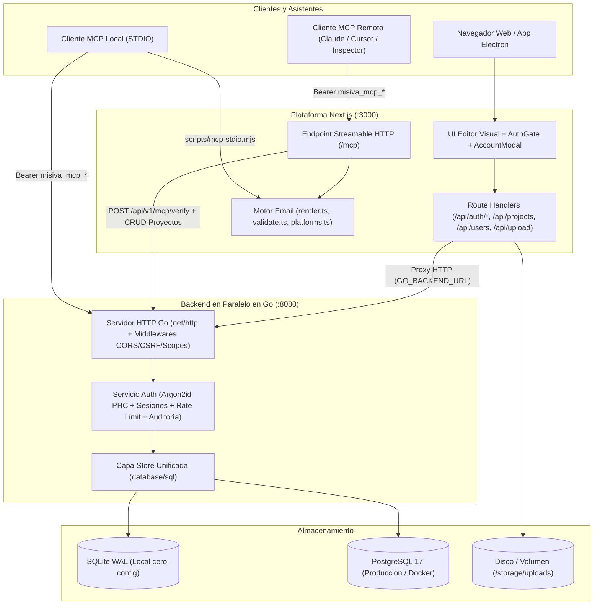

# Arquitectura de Misiva (Frontend Next.js + Backend en Go + MCP)

Este documento describe el resultado del escaneo técnico de **Misiva (Mailing Studio)** y la arquitectura híbrida implementada con un **backend en paralelo en Go** y el **servidor MCP v0.2**.

---

## 1. Diagnóstico del Proyecto Original

Al escanear el repositorio se identificaron los siguientes componentes y limitaciones iniciales:

- **Editor Visual y Motor de Renderizado (`lib/email/*`, `components/editor/*`)**:
  - Construido sobre **Next.js 16.4 (App Router)** y **React 19**, con soporte opcional de escritorio mediante **Electron 45**.
  - Motor propio de compilación de bloques a HTML compatible con clientes de correo (`render.ts`: tablas `role="presentation"`, tabla fantasma y botones/portadas VML para Outlook escritorio, modo oscuro y traducción de merge tags para 14 plataformas).
- **Limitaciones previas de Autenticación y Persistencia**:
  - La autenticación vivía acoplada a rutas internas de Next.js y exigía obligatoriamente una instancia externa de PostgreSQL (`DATABASE_URL`). En entornos locales sin PostgreSQL no existían cuentas, sesiones ni generación de tokens MCP personales.
  - No había gestión de perfil, cambio de contraseña, control de sesiones activas por dispositivo, bitácora de auditoría ni administración de usuarios.
- **Limitaciones previas del Servidor MCP**:
  - Solo exponía 5 herramientas básicas (`list_projects`, `get_project`, `create_mailing`, `save_project`, `render_project`).
  - Para realizar cualquier cambio mínimo, el asistente de IA debía reenviar el JSON íntegro del documento (`save_project`), fallando con frecuencia ante validaciones estrictas sin diagnóstico del campo erróneo.
  - Carecía de edición granular por bloques, recursos MCP (`misiva://`), prompts guiados, validación de permisos (`scopes`) por token y modo de transporte `stdio`.

---

## 2. Arquitectura en Paralelo Implementada

---

## 3. Modos de Ejecución Soportados

La arquitectura conserva **retrocompatibilidad total** y permite tres modos de operación:

| Modo | Variables clave | Dónde viven usuarios y proyectos | Caso de uso ideal |
| --- | --- | --- | --- |
| **1. Paralelo con Go + SQLite (Recomendado en desarrollo)** | `npm run dev:full` (`GO_BACKEND_URL=http://127.0.0.1:8080`) | `storage/misiva.db` (SQLite WAL automático, sin Docker) | Desarrollo local inmediato con sistema completo de cuentas, admin y MCP. |
| **2. Paralelo con Go + PostgreSQL (Recomendado en producción)** | `docker compose up -d --build` (`DB_DRIVER=postgres`) | Volumen `postgres_data` gestionado por `backend-go` | Despliegue multiusuario en servidor propio o nube. |
| **3. Autónomo Local / Electron** | Sin `GO_BACKEND_URL` ni `DATABASE_URL` | `localStorage` / `storage/projects/*.json` | Uso individual de escritorio sin cuentas. |

---

## 4. Mapa de Archivos Nuevos y Modificados

- **Backend en Go (`/backend`)**:
  - `backend/cmd/server/main.go`: Arranque HTTP con apagado ordenado (*graceful shutdown*).
  - `backend/internal/config/config.go`: Configuración por entorno y autodetección de SQLite/PostgreSQL.
  - `backend/internal/security/password.go`: Hashing **Argon2id** en formato PHC estándar (100% compatible con `@node-rs/argon2`), SHA-256 y generación de tokens criptográficos.
  - `backend/internal/store/store.go` y `sqlstore.go`: Persistencia transaccional dual para usuarios, sesiones, tokens con scopes, proyectos con concurrencia optimista, assets y auditoría.
  - `backend/internal/server/*.go`: Router REST `/api/v1/*`, middlewares de sesión/token/admin, protección CSRF y pruebas end-to-end (`server_test.go`).
- **Puente e Interfaz en Next.js**:
  - `lib/server/go-backend.ts`: Cliente HTTP servidor-a-servidor y proxy transparente de cookies/cabeceras hacia Go.
  - `app/api/auth/*`, `app/api/users/route.ts`, `app/api/projects/route.ts`, `app/api/upload/route.ts`: Integración con el backend en Go manteniendo fallback limpio.
  - `components/auth/AuthGate.tsx` y `components/auth/AccountModal.tsx`: Nueva interfaz con pestañas para **Tokens MCP con Scopes + JSON copiable**, **Perfil, Contraseña y Sesiones Activas**, y **Administración de Usuarios**.
- **Servidor MCP v0.2**:
  - `lib/mcp/server.ts`: 18 herramientas, 5 recursos (`misiva://`) y 3 prompts guiados.
  - `app/mcp/route.ts`: Endpoint Streamable HTTP con CORS, validación en Go y control de permisos por token.
  - `scripts/mcp-stdio.mjs` y `scripts/mcp-loader.mjs`: Transporte `stdio` nativo sobre Node.js sin pasos de compilación adicionales.
